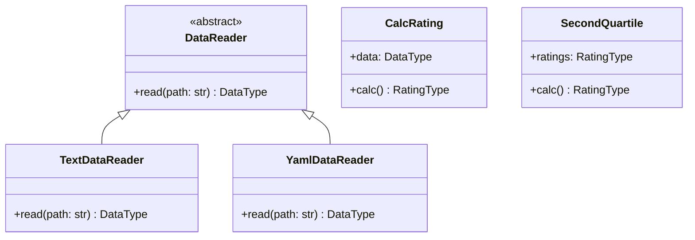

# Лабораторная работа № 1 — Вариант 8


**Дисциплина:** Технологии программирования  
**Тема:** Git и непрерывная интеграция с GitHub Actions  
**Автор:** Majid Albadwi  
**Репозиторий:** https://github.com/ALBADWIMAJID/PTLab1

## Цель работы

Освоить управление версиями с помощью Git, разработку
объектно-ориентированной программы, модульное тестирование
и автоматическую проверку проекта средствами GitHub Actions.

## Постановка задачи

Базовая программа читает оценки студентов из текстового файла
и вычисляет средний арифметический балл каждого студента.

Индивидуальное задание, вариант 8:

1. Реализовать наследника DataReader для чтения YAML.
2. Реализовать отдельный класс для определения студентов,
   чей рейтинг попадает во второй квартиль распределения.
3. Разработать тесты, выполнить работу в отдельных ветках
   и объединить проверенные изменения с main.
4. Добавить лицензию, .gitignore и UML-диаграмму классов.

## Технологии

- Python 3.13.
- PyYAML — чтение YAML.
- statistics — вычисление квартилей.
- argparse — интерфейс командной строки.
- pytest — автоматические тесты.
- pycodestyle — проверка стиля.
- Git, GitHub и GitHub Actions — версии и непрерывная интеграция.

## Структура проекта

| Путь | Назначение |
|---|---|
| `src/DataReader.py` | Абстрактный интерфейс чтения |
| `src/TextDataReader.py` | Чтение TXT |
| `src/YamlDataReader.py` | Чтение YAML и проверка структуры |
| `src/CalcRating.py` | Расчёт средних баллов |
| `src/SecondQuartile.py` | Отбор студентов второго квартиля |
| `src/Types.py` | Общие типы данных |
| `src/main.py` | Интерфейс командной строки |
| `test/` | Модульные и интеграционные тесты |
| `data/` | Примеры входных данных |
| `.github/workflows/github-actions-testing.yml` | Настройка CI |
| `requirements.txt` | Зависимости |
| `.gitignore` | Исключения для Git |
| `LICENSE` | Текст лицензии |

## Форматы данных

### TXT

Имя студента записывается без отступа, дисциплины и оценки —
с отступом в формате `предмет:оценка`.

```text
Иванов Иван
    математика:80
    физика:90
```

### YAML

Используется список записей. Каждая запись содержит одного студента
и словарь его дисциплин и целочисленных оценок.

```yaml
- Иванов Иван:
    математика: 80
    физика: 90
- Петров Петр:
    математика: 70
    физика: 60
```

YamlDataReader использует `yaml.safe_load`.
Проверяются структура записей, непустые имена, наличие дисциплин,
целочисленный тип оценок и повторение студентов в отдельных записях.
Логические значения не принимаются как оценки.

Пустой YAML-файл возвращает пустой словарь.
Некорректная структура или синтаксис приводят к ValueError,
отсутствующий файл — к FileNotFoundError.

## Алгоритм второго квартиля

Рейтинг студента — среднее арифметическое его оценок:

`rating = sum(scores) / len(scores)`

Границы вычисляются функцией:

```python
statistics.quantiles(ratings, n=4, method="inclusive")
```

Метод inclusive использует линейную интерполяцию между
упорядоченными значениями. Минимум соответствует 0-му процентилю,
максимум — 100-му.

Поскольку методические указания не задают способ вычисления границ
и обработки совпадающих значений, в проекте принято правило:

`Q1 < rating <= Q2`

Здесь Q1 — 25-й процентиль, Q2 — медиана.

- Значение, равное Q1, исключается.
- Значение, равное Q2, включается, если оно больше Q1.
- Студенты с одинаковыми подходящими рейтингами включаются все.
- При количестве студентов менее двух возвращается пустой результат.
- При Q1 = Q2 интервал пуст, поэтому результат также пуст.
- Число выбранных студентов не обязано составлять ровно 25%,
  особенно при совпадающих оценках и небольшом наборе данных.
- Округление до отбора не выполняется.

### Контрольный пример

Файл `data/quartile_demo.yaml`:

| Студент | Оценки | Рейтинг |
|---|---|---|
| A | 40, 60 | 50 |
| B | 50, 70 | 60 |
| C | 60, 80 | 70 |
| D | 70, 90 | 80 |

Получаем Q1 = 57.5 и Q2 = 65.
Условию соответствует студент B с рейтингом 60.

## UML-диаграмма классов



DataType — словарь имён студентов и списков пар
«дисциплина, оценка». RatingType — словарь имён и средних баллов.

Модуль main выбирает реализацию DataReader по расширению файла,
передаёт данные в CalcRating и, при наличии соответствующего флага,
передаёт рассчитанные рейтинги в SecondQuartile.
CalcRating и SecondQuartile не вызывают друг друга напрямую.

## Установка

Команды выполняются из корня проекта.

```bat
python -m venv .venv
.venv\Scripts\activate.bat
python -m pip install -r requirements.txt
```

В PowerShell окружение активируется командой:

```powershell
.\.venv\Scripts\Activate.ps1
```

## Запуск

Все рейтинги из TXT:

```bat
python -m src.main -p data/data.txt
```

Все рейтинги из YAML:

```bat
python -m src.main -p data/data.yaml
```

Только студенты второго квартиля:

```bat
python -m src.main -p data/quartile_demo.yaml --second-quartile
```

Ожидаемый результат:

```text
B: 60.0
```

Поддерживаются расширения `.txt`, `.yaml`, `.yml`.
Если подходящих студентов нет, выводится:

```text
No students in the second quartile.
```

## Тестирование

```bat
python -m pytest test -v
python -m pycodestyle src test
```

При локальной проверке успешно выполнены 52 теста.
Проверка pycodestyle завершилась без замечаний.

Проверены:

- расчёт средних баллов и отсутствие оценок;
- чтение TXT и YAML, некорректные данные и отсутствующие файлы;
- повторное использование объекта чтения;
- границы квартилей, совпадающие и дробные рейтинги;
- пустые данные, один и два студента;
- независимость результата от порядка входных записей;
- запуск CLI, YAML/YML и сообщение об отсутствии результата.

Число успешных тестов не является измерением покрытия кода.

## Git и непрерывная интеграция

Дополнения разрабатывались в отдельных ветках:

- `feature/yaml-reader` — чтение YAML и тесты;
- `feature/second-quartile` — отбор студентов и интеграция с CLI.

Изменения объединены с main через pull requests.

Workflow запускается при push, pull request и вручную.
На Ubuntu устанавливаются Python 3.13 и зависимости, затем
выполняются pycodestyle и pytest.

Проведена учебная проверка CI: добавлен заведомо ошибочный тест,
зафиксирован неуспешный запуск, затем тест удалён.
После удаления подтверждено успешное выполнение 17 базовых тестов.

При разработке YAML-reader CI также обнаружил W292 —
отсутствие перевода строки в конце двух файлов.
После исправления проверки ветки и pull request завершились успешно.

История запусков:
https://github.com/ALBADWIMAJID/PTLab1/actions

## Лицензия

MIT, текст приведён в файле LICENSE.
Базовая постановка задачи и архитектура взяты из методических
указаний к лабораторной работе № 1.

## Выводы

Реализована программа чтения оценок из TXT и YAML,
вычисления средних баллов и отбора студентов второго квартиля.
Разделение чтения, расчёта рейтинга и отбора упрощает тестирование.

Освоены создание веток, фиксация изменений, работа с удалённым
репозиторием и объединение изменений через pull requests.
Настроенная CI-проверка позволила обнаруживать ошибки тестов
и нарушения стиля до завершения интеграции изменений.

## Источники

- Методические указания `TP_Lab1_CI_CD_GitHub.pdf`, вариант 8.
- [Git](https://git-scm.com/doc)
- [GitHub Actions для Python](https://docs.github.com/en/actions/tutorials/build-and-test-code/python)
- [PyYAML](https://pyyaml.org/wiki/PyYAMLDocumentation)
- [statistics.quantiles](https://docs.python.org/3/library/statistics.html#statistics.quantiles)
- [pytest](https://docs.pytest.org/en/stable/)
- [pycodestyle](https://pycodestyle.pycqa.org/en/latest/)