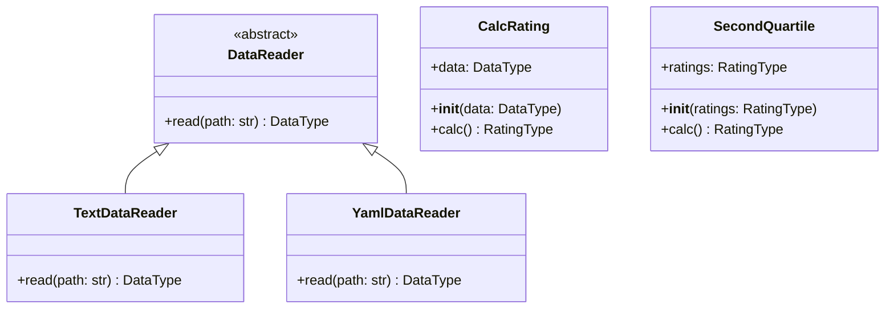

# Лабораторная работа № 1 — Вариант 8

[](https://github.com/ALBADWIMAJID/PTLab1/actions)

**Дисциплина:** Технологии программирования  
**Тема:** Система контроля версий Git и непрерывная интеграция с GitHub Actions  
**Автор:** Majid Albadwi  
**Вариант:** 8

## 1. Цель работы

Получить практические навыки использования Git, разработки
объектно-ориентированных программ на Python, создания автоматических
тестов и настройки непрерывной интеграции с помощью GitHub Actions.

## 2. Постановка задачи

Базовая программа читает оценки студентов из текстового файла
и вычисляет средний арифметический балл каждого студента.

В соответствии с вариантом 8 необходимо:

1. Разработать класс-наследник `DataReader` для чтения файлов YAML.
2. Разработать отдельный класс для определения всех студентов,
   чей рейтинг попадает во второй квартиль распределения рейтингов.
3. Создать автоматические тесты для реализованных возможностей.
4. Выполнить разработку в отдельных ветках и объединить изменения
   с основной веткой после успешной проверки.
5. Добавить `.gitignore`, лицензию и UML-диаграмму классов.
6. Описать результаты и сформулировать выводы.

## 3. Используемые технологии

| Технология | Назначение |
|---|---|
| Python 3.13 | Язык реализации |
| PyYAML | Чтение YAML |
| statistics | Вычисление квартилей |
| argparse | Обработка аргументов командной строки |
| pytest | Модульные и интеграционные тесты |
| pycodestyle | Проверка стиля Python-кода |
| Git | Управление версиями |
| GitHub | Хранение репозитория и pull requests |
| GitHub Actions | Автоматическая проверка изменений |

`statistics` и `argparse` входят в стандартную библиотеку Python.
Внешние зависимости перечислены в `requirements.txt`.

## 4. Структура проекта

| Файл или каталог | Назначение |
|---|---|
| `src/DataReader.py` | Абстрактный интерфейс чтения данных |
| `src/TextDataReader.py` | Чтение текстовых файлов |
| `src/YamlDataReader.py` | Чтение YAML и проверка структуры данных |
| `src/CalcRating.py` | Вычисление средних баллов |
| `src/SecondQuartile.py` | Отбор студентов второго квартиля |
| `src/Types.py` | Общие определения типов |
| `src/main.py` | Точка входа и интерфейс командной строки |
| `test/` | Автоматические тесты |
| `data/data.txt` | Базовый пример TXT |
| `data/data.yaml` | Базовый пример YAML |
| `data/quartile_demo.yaml` | Контрольный пример второго квартиля |
| `.github/workflows/github-actions-testing.yml` | Настройка GitHub Actions |
| `requirements.txt` | Внешние зависимости |
| `.gitignore` | Исключение служебных файлов из Git |
| `LICENSE` | Лицензия |
| `README.md` | Описание проекта и отчёт |

## 5. Форматы входных данных

### 5.1. TXT

Имя студента записывается без отступа.
Строки с дисциплинами имеют отступ и формат `предмет:оценка`.

```text
Иванов Иван
    математика:80
    физика:90
Петров Петр
    математика:70
    физика:60
```

Пустые строки пропускаются.
При отсутствии оценки, некорректном числе или появлении дисциплины
до имени студента возникает `ValueError`.

### 5.2. YAML

Файл содержит список записей.
Каждая запись описывает одного студента и словарь его дисциплин.

```yaml
- Иванов Иван:
    математика: 80
    физика: 90
- Петров Петр:
    математика: 70
    физика: 60
```

Для загрузки используется `yaml.safe_load`.

Класс `YamlDataReader` проверяет:

- наличие списка записей на верхнем уровне;
- наличие ровно одного студента в каждой записи;
- непустые строковые имена студентов и дисциплин;
- наличие непустого словаря дисциплин;
- целочисленный тип оценок;
- отсутствие повторных студентов в отдельных записях.

Логические значения `true` и `false` не принимаются как оценки.
Пустой файл или пустой список возвращает пустой словарь.

Ошибки синтаксиса YAML и нарушения структуры приводят к `ValueError`.
При отсутствии файла возникает `FileNotFoundError`.

В текущей реализации проверяется тип оценки, но не её диапазон.
Для учебных примеров используются баллы от 0 до 100.

### 5.3. Внутреннее представление

После чтения обе реализации возвращают одинаковую структуру:

```python
DataType = dict[str, list[tuple[str, int]]]
RatingType = dict[str, float]
```

Пример данных:

```python
{
    "Иванов Иван": [("математика", 80), ("физика", 90)],
    "Петров Петр": [("математика", 70), ("физика", 60)],
}
```

Общий формат позволяет выполнять расчёты независимо от формата файла.

## 6. Алгоритм расчёта

### 6.1. Средний рейтинг

Класс `CalcRating` вычисляет среднее арифметическое оценок студента:

```text
rating = сумма оценок / количество дисциплин
```

Если у студента нет оценок, возникает `ValueError`.
Для пустого набора студентов возвращается пустой словарь.

### 6.2. Второй квартиль

Класс `SecondQuartile` получает словарь рассчитанных рейтингов.

Для двух и более студентов границы квартилей вычисляются так:

```python
from statistics import quantiles

q1, q2, q3 = quantiles(
    ratings.values(),
    n=4,
    method="inclusive",
)
```

Используются значения словаря — средние баллы, а не имена студентов.

Метод `inclusive` использует линейную интерполяцию между
упорядоченными значениями. Минимальное значение соответствует
0-му процентилю, максимальное — 100-му.

Здесь:

- `Q1` — 25-й процентиль;
- `Q2` — 50-й процентиль, или медиана;
- `Q3` — 75-й процентиль.

Методические указания не уточняют способ расчёта границ
и обработки совпадающих значений. В проекте принято следующее
правило принадлежности второму квартильному интервалу:

```text
Q1 < rating <= Q2
```

Особенности реализации:

- рейтинг, равный Q1, исключается;
- рейтинг, равный Q2, включается, если он больше Q1;
- все студенты с одинаковым подходящим рейтингом включаются;
- при количестве студентов менее двух возвращается пустой результат;
- при Q1 = Q2 интервал пуст;
- перед сравнением рейтинги не округляются;
- исходный словарь рейтингов не изменяется.

При совпадающих значениях и небольших наборах данных количество
отобранных студентов не обязано составлять ровно 25%.
Даже для непустого входного набора результат может быть пустым.

### 6.3. Контрольный пример

В файле `data/quartile_demo.yaml` находятся следующие данные:

| Студент | Оценки | Средний рейтинг |
|---|---|---|
| A | 40, 60 | 50.0 |
| B | 50, 70 | 60.0 |
| C | 60, 80 | 70.0 |
| D | 70, 90 | 80.0 |

Для рейтингов `50, 60, 70, 80`:

```text
Q1 = 57.5
Q2 = 65.0
Q3 = 72.5
```

Только студент B удовлетворяет условию:

```text
57.5 < 60.0 <= 65.0
```

Ожидаемый вывод:

```text
B: 60.0
```

## 7. UML-диаграмма классов



`TextDataReader` и `YamlDataReader` реализуют общий интерфейс
абстрактного класса `DataReader`.

`CalcRating` отвечает за расчёт средних баллов.
`SecondQuartile` отвечает за отбор по рассчитанным рейтингам.

Эти два класса не вызывают друг друга напрямую.
Их взаимодействие организует модуль `main`:

1. Определяет формат файла по расширению.
2. Создаёт соответствующий объект чтения.
3. Передаёт прочитанные данные в `CalcRating`.
4. При наличии `--second-quartile` передаёт рейтинги в `SecondQuartile`.
5. Выводит результат.

Модуль `main` не представлен отдельным классом,
поскольку в программе он реализован функциями.

## 8. Установка

Требуется установленный Python 3.13.
Все команды выполняются из корня проекта.

### Windows CMD

```bat
python -m venv .venv
.venv\Scripts\activate.bat
python -m pip install -r requirements.txt
```

Если окружение уже создано, повторно создавать его не нужно.

### PowerShell

Для активации существующего окружения:

```powershell
.\.venv\Scripts\Activate.ps1
```

### Отображение кириллицы в CMD

При некорректном отображении UTF-8 можно переключить кодовую страницу:

```bat
chcp 65001
```

Файлы данных и README сохраняются в UTF-8.

## 9. Запуск программы

### Все рейтинги из TXT

```bat
python -m src.main -p data/data.txt
```

### Все рейтинги из YAML

```bat
python -m src.main -p data/data.yaml
```

### Студенты второго квартиля

```bat
python -m src.main -p data/quartile_demo.yaml --second-quartile
```

### Справка

```bat
python -m src.main --help
```

Поддерживаются расширения `.txt`, `.yaml`, `.yml`.
Параметры `-p` и `--path` эквивалентны.

Без флага `--second-quartile` программа выводит все средние рейтинги.
С этим флагом выводятся только студенты выбранного интервала.

При отсутствии подходящих студентов выводится:

```text
No students in the second quartile.
```

Для пути с пробелами следует использовать кавычки:

```bat
python -m src.main -p "data/student grades.yaml" --second-quartile
```

## 10. Тестирование

Запуск тестов:

```bat
python -m pytest test -v
```

Проверка стиля:

```bat
python -m pycodestyle src test
```

В проверенной версии успешно выполнены **52 теста**.
`pycodestyle` завершился без замечаний.

| Область | Основные проверки |
|---|---|
| CalcRating | Средние баллы, пустые данные, отсутствие оценок |
| TextDataReader | UTF-8, пустые строки, ошибочные записи, отсутствующий файл |
| YamlDataReader | Структура YAML, типы оценок, дубликаты студентов, ошибки синтаксиса |
| Повторное чтение | Отсутствие накопления данных между вызовами |
| SecondQuartile | Границы, совпадения, дробные значения, порядок данных |
| Малые наборы | Ноль, один и два студента |
| CLI | Аргументы, TXT, YAML/YML, фильтрация и пустой результат |

В интеграционных тестах интерфейс командной строки запускается
в отдельном процессе и проверяется его вывод.

Количество успешных тестов не является показателем процента
покрытия кода: отдельное измерение покрытия не проводилось.

## 11. Работа с Git и GitHub Actions

Разработка индивидуального задания выполнялась в ветках:

| Ветка | Изменения |
|---|---|
| `feature/yaml-reader` | Чтение YAML и соответствующие тесты |
| `feature/second-quartile` | Расчёт второго квартиля, CLI и тесты |

Изменения объединены с `main` через pull requests:

- [Pull request № 1](https://github.com/ALBADWIMAJID/PTLab1/pull/1)
- [Pull request № 2](https://github.com/ALBADWIMAJID/PTLab1/pull/2)

Workflow находится в
`.github/workflows/github-actions-testing.yml`
и запускается при `push`, `pull_request`, а также вручную
через `workflow_dispatch`.

На GitHub-hosted runner с Ubuntu выполняются:

1. Получение кода репозитория.
2. Настройка Python 3.13.
3. Установка зависимостей.
4. Проверка стиля с помощью pycodestyle.
5. Запуск тестов pytest.

Если проверка стиля завершается с ошибкой,
следующий шаг тестирования не выполняется.

### Проверка обнаружения ошибки

Для демонстрации CI был добавлен временный тест
с заведомо неверным утверждением `1 + 1 == 3`.
После его добавления зафиксирован неуспешный запуск workflow.

Затем временный тест был удалён.
Следующий запуск успешно выполнил 17 базовых тестов.

При разработке YAML-reader также обнаружены замечания W292
об отсутствии перевода строки в конце файлов.
После исправления проверки завершились успешно.

[История запусков GitHub Actions](https://github.com/ALBADWIMAJID/PTLab1/actions)

## 12. Исключение служебных файлов

Файл `.gitignore` исключает:

- виртуальное окружение `.venv`;
- кэш Python и pytest;
- скомпилированные файлы Python;
- файлы результатов измерения покрытия;
- локальный файл `.env`.

Исходный код, тесты, примеры данных и настройки CI
хранятся в репозитории.

## 13. Лицензия и происхождение проекта

Для проекта выбрана лицензия MIT.
Полный текст лицензии должен находиться в файле [LICENSE](LICENSE).

Базовая постановка задачи и архитектура проекта основаны
на методических указаниях к лабораторной работе № 1.
Индивидуальные дополнения соответствуют варианту 8.

## 14. Выводы

Разработана программа для чтения оценок из TXT и YAML,
расчёта средних рейтингов и определения студентов,
попадающих во второй квартильный интервал.

Общий интерфейс DataReader позволяет добавлять новые форматы
без изменения классов расчёта. Разделение обязанностей между
классами упрощает проверку отдельных компонентов.

Разработаны и успешно выполнены 52 автоматических теста.
Проверены обычные сценарии, ошибочные данные и граничные случаи.
Для квартилей явно зафиксированы способ вычисления границ
и правила обработки совпадающих рейтингов.

Освоены работа с ветками Git, фиксация изменений,
публикация в удалённом репозитории и объединение через pull requests.
Настроен CI, автоматически проверяющий стиль и тесты.
Практическая проверка показала обнаружение ошибок
и восстановление успешного состояния после исправления.

## 15. Источники

1. Методические указания `TP_Lab1_CI_CD_GitHub.pdf`,
   индивидуальное задание, вариант 8.
2. [Документация Git](https://git-scm.com/doc)
3. [GitHub Actions: сборка и тестирование Python](https://docs.github.com/en/actions/tutorials/build-and-test-code/python)
4. [Документация PyYAML](https://pyyaml.org/wiki/PyYAMLDocumentation)
5. [Python: statistics.quantiles](https://docs.python.org/3/library/statistics.html#statistics.quantiles)
6. [Документация pytest](https://docs.pytest.org/en/stable/)
7. [Документация pycodestyle](https://pycodestyle.pycqa.org/en/latest/)
8. [Текст лицензии MIT](https://choosealicense.com/licenses/mit/)